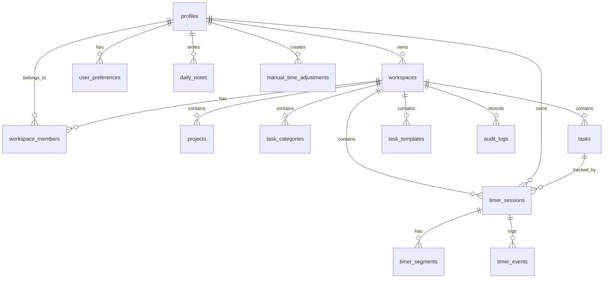

# WorkLog — Database Design

## 1. Database Platform

The platform will use Supabase PostgreSQL with Supabase Authentication and Row Level Security. The schema is designed as a normalized, workspace-aware data model that supports personal and small-team scenarios without unnecessary enterprise complexity.

## 2. Core Design Principles

- use UUIDs for primary keys
- use foreign keys for relational integrity
- keep workspace data separated from private user data
- enforce user identity and workspace membership through RLS
- store timezone-aware timestamps
- keep immutable timer event history where practical
- keep calculation logic source-of-truth in database-backed aggregates, not browser state

## 3. Entity Relationship Overview

## 4. Core Tables

### profiles

Stores the authenticated user record and private settings linked to the auth user.

Key fields:

- `id` UUID PK
- `email` text
- `full_name` text
- `avatar_url` text nullable
- `timezone` text default `Asia/Kolkata`
- `created_at` timestamptz
- `updated_at` timestamptz

### workspaces

Represents a private or shared workspace.

Key fields:

- `id` UUID PK
- `owner_user_id` UUID FK to `profiles`
- `name` text
- `description` text nullable
- `is_personal` boolean default true
- `created_at` timestamptz
- `updated_at` timestamptz

### workspace_members

Links users to workspaces and roles.

Key fields:

- `id` UUID PK
- `workspace_id` UUID FK to `workspaces`
- `user_id` UUID FK to `profiles`
- `role` text check in (`owner`, `admin`, `member`)
- `status` text check in (`active`, `invited`, `archived`)
- `created_at` timestamptz

### projects

Organizes work by project.

Key fields:

- `id` UUID PK
- `workspace_id` UUID FK
- `name` text
- `description` text nullable
- `color` text nullable
- `status` text check in (`active`, `archived`)
- `created_by` UUID FK to `profiles`
- `created_at` timestamptz
- `updated_at` timestamptz

### task_categories

User-defined categories for tasks.

Key fields:

- `id` UUID PK
- `workspace_id` UUID FK
- `name` text
- `color` text nullable
- `description` text nullable
- `created_by` UUID FK
- `created_at` timestamptz

### tasks

Represents tracked work items.

Key fields:

- `id` UUID PK
- `workspace_id` UUID FK
- `project_id` UUID FK nullable
- `category_id` UUID FK nullable
- `title` text
- `description` text nullable
- `priority` text check in (`low`, `medium`, `high`, `urgent`)
- `status` text check in (`not_started`, `in_progress`, `paused`, `completed`, `cancelled`)
- `estimated_duration_minutes` integer nullable
- `actual_duration_minutes` integer nullable
- `start_date` date nullable
- `due_date` date nullable
- `completed_at` timestamptz nullable
- `tags` text[] default '{}'
- `notes` text nullable
- `created_by` UUID FK
- `assignee_id` UUID FK nullable
- `created_at` timestamptz
- `updated_at` timestamptz

### task_templates

Reusable templates for faster task creation.

Key fields:

- `id` UUID PK
- `workspace_id` UUID FK
- `name` text
- `task_title` text
- `description` text nullable
- `project_id` UUID FK nullable
- `category_id` UUID FK nullable
- `priority` text
- `estimated_duration_minutes` integer nullable
- `tags` text[] default '{}'
- `notes` text nullable
- `created_by` UUID FK
- `created_at` timestamptz
- `updated_at` timestamptz

### timer_sessions

One logical timer activity, such as a task session, break session, or lunch session.

Key fields:

- `id` UUID PK
- `workspace_id` UUID FK
- `user_id` UUID FK to `profiles`
- `task_id` UUID FK nullable
- `session_type` text check in (`task`, `break`, `lunch`, `other`)
- `status` text check in (`running`, `paused`, `completed`, `cancelled`)
- `started_at` timestamptz
- `ended_at` timestamptz nullable
- `description` text nullable
- `created_at` timestamptz
- `updated_at` timestamptz

### timer_segments

Actual active intervals within a timer session.

Key fields:

- `id` UUID PK
- `timer_session_id` UUID FK
- `segment_start` timestamptz
- `segment_end` timestamptz nullable
- `status` text check in (`active`, `paused`, `completed`)
- `created_at` timestamptz
- `updated_at` timestamptz

### timer_events

Immutable audit log of timer actions.

Key fields:

- `id` UUID PK
- `timer_session_id` UUID FK
- `event_type` text check in (`started`, `paused`, `resumed`, `completed`, `cancelled`, `adjusted`)
- `event_timestamp` timestamptz
- `metadata` jsonb default '{}'
- `created_by` UUID FK
- `created_at` timestamptz

### manual_time_adjustments

Tracks manual updates or corrections to historical data.

Key fields:

- `id` UUID PK
- `workspace_id` UUID FK
- `user_id` UUID FK
- `task_id` UUID nullable
- `timer_session_id` UUID nullable
- `adjustment_type` text check in (`manual_add`, `manual_subtract`, `correction`, `reclassification`)
- `minutes_delta` integer
- `reason` text
- `created_at` timestamptz

### user_preferences

Stores user-specific UI and work preference settings.

Key fields:

- `id` UUID PK
- `user_id` UUID FK
- `daily_productive_target_minutes` integer default 480
- `preferred_work_days` text[] default '{}'
- `default_task_category_id` UUID nullable
- `default_project_id` UUID nullable
- `time_zone` text default `Asia/Kolkata`
- `time_format` text check in (`12h`, `24h`)
- `date_format` text
- `theme` text check in (`light`, `dark`, `system`)
- `created_at` timestamptz
- `updated_at` timestamptz

### daily_notes

Optional daily notes and updates.

Key fields:

- `id` UUID PK
- `user_id` UUID FK
- `note_date` date
- `content` text
- `created_at` timestamptz
- `updated_at` timestamptz

### audit_logs

Critical audit table for sensitive actions.

Key fields:

- `id` UUID PK
- `workspace_id` UUID FK nullable
- `user_id` UUID FK nullable
- `entity_type` text
- `entity_id` UUID
- `action` text
- `details` jsonb default '{}'
- `created_at` timestamptz

## 5. Business Rules

### Timer integrity

- A user cannot have multiple `running` timer sessions simultaneously.
- `timer_segments` must not overlap for the same active session.
- Paused time is excluded from total productive time.
- Timer actions produce immutable events in `timer_events`.
- Timer state transitions must be performed in a transaction.

### Workspace safety

- every workspace-scoped table must reference `workspace_id`
- RLS must prevent cross-workspace reads and writes
- no unauthenticated access to user-private tables

### Reporting consistency

- all reports must aggregate from the same database source
- `manual_time_adjustments` are separate from automatic timer segments
- cancelled tasks are excluded from productive calculations unless intentionally included by a specific business rule

## 6. Suggested Indexes

Key indexes should be added for:

- `timer_sessions(user_id, status, started_at)`
- `timer_sessions(workspace_id, session_type, started_at)`
- `timer_segments(timer_session_id, segment_start, segment_end)`
- `tasks(workspace_id, status, due_date)`
- `tasks(workspace_id, created_by, start_date)`
- `task_templates(workspace_id, created_by)`
- `audit_logs(workspace_id, created_at)`
- `manual_time_adjustments(user_id, created_at)`

## 7. RLS Strategy

Each table should have row-level policies that check:

- authenticated user exists
- user is a member of the relevant workspace
- owner/admin/member permissions align with the operation

Examples:

- `profiles`: user can read/update their own row only
- `workspaces`: members can read their workspace rows, owner/admin can mutate
- `tasks`: workspace members can read workspace tasks; owners/admins or creator/assignee may mutate within allowed rules
- `timer_sessions`: user can read/write their own records and workspace-shared records when permitted
- `audit_logs`: restricted to relevant workspace owner/admin members or internal service processes

## 8. Implementation Notes

The database should be implemented through versioned migrations under `supabase/migrations/` and ideally validated via Supabase CLI tooling where available. The schema should remain straightforward enough to be recreated from SQL migrations without manual ad hoc database edits.

## 9. Risks and Assumptions

- The application should not rely on browser timestamps as a timer source of truth.
- Time zone handling needs explicit user-local conversion in aggregations.
- Some historical corrections may require endpoint design decisions around immutability vs. append-only adjustment records.
- Reporting logic must unify calculations across dashboard, history, and export modules.

This is the baseline database schema to be refined during Phase 2 and implemented in the migration stack during the service implementation phases.
