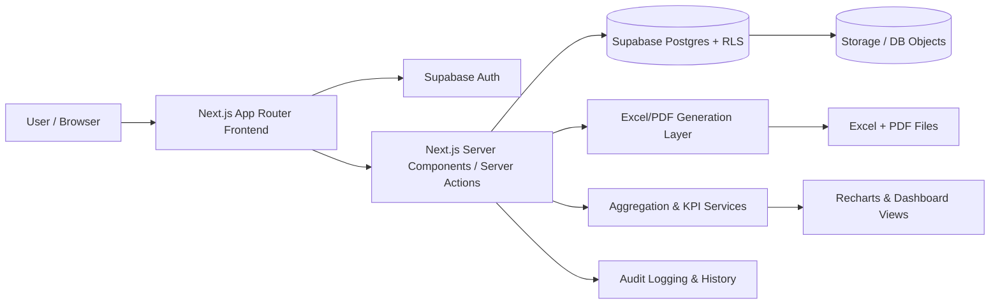

# WorkLog — System Architecture

## 1. Architectural Summary

WorkLog is designed as a modular, feature-based application built on the Next.js App Router. The system separates concerns into:

- presentation layer
- server-side business logic
- data-access layer
- integration layer with Supabase
- export/reporting services
- analytics aggregation services

The architecture prioritizes correctness for time tracking and reporting before UI convenience.

## 2. High-Level Architecture Diagram



## 3. Layered Design

### Presentation layer

- app router pages and layouts
- reusable UI components from shadcn/ui
- responsive dashboard and forms
- chart display components for analytics

### Application layer

- feature modules grouped by business capability
- validated server actions and route handlers
- shared domain logic for tasks, timers, time calculations, and exports

### Data layer

- Supabase PostgreSQL
- RLS policies by workspace and owner
- SQL migrations managed in version control
- server-side queries using authenticated session context

## 4. Feature-Based Module Map

```text
src/
  app/
    (auth)/
    (dashboard)/
    api/
  components/
    ui/
    layout/
    dashboard/
    charts/
    forms/
    shared/
  features/
    auth/
    tasks/
    templates/
    timer/
    breaks/
    history/
    analytics/
    reports/
    projects/
    settings/
  lib/
    supabase/
    validations/
    date/
    time-tracking/
    exports/
    utils/
  hooks/
  types/
  config/
```

## 5. Authentication and Authorization Architecture

### Authentication

- Supabase Authentication handles sign up, sign in, sessions, password reset, and JWT/session lifecycle.
- The Next.js app will use the SSR-compatible Supabase auth flow for the installed version.
- Server components and server actions will validate the active session before reading or writing protected data.

### Authorization

- RLS is enforced in Postgres.
- Workspace membership is checked at the database layer.
- User identity must never be trusted from client-only state.
- Sensitive operations must validate both user identity and workspace membership on the server.

## 6. Time Tracking Architecture

The critical architecture is centered around three database entities:

- `timer_sessions`: a logical activity block for a task or break
- `timer_segments`: actual active time intervals excluding pauses
- `timer_events`: immutable audit trail of state transitions

This prevents the timing logic from depending solely on browser timers.

### Core timing principle

Actual tracked time is calculated from database timestamps, not JavaScript clock logic. JavaScript is only used to update visible countdowns and elapsed displays.

### Timer states

- idle
- running
- paused
- completed
- cancelled

### Business rules enforced by design

- only one active timer session per user at a time
- multiple historical sessions are allowed
- paused periods are excluded from productive calculations
- overlapping segments are prevented by constraints and transaction logic
- task and break switches must be explicit and auditable

## 7. Data Access Strategy

### Server-first queries

- use server actions or route handlers for writes
- use server components for reads where possible
- fetch only the minimal data needed for each page

### Data sharing model

- personal data belongs to the authenticated user
- workspace data is shared by membership and role
- shared data queries must be scoped to the active workspace

### Caching and performance

- avoid large unpaginated historical reads on dashboard pages
- aggregate analytics at query time where possible
- keep dashboard data focused on recent periods and summarized views
- use database indexes for date, status, and user/workspace filters

## 8. Security Model

The application security posture is based on defense in depth:

- Supabase Auth session validation
- Postgres RLS for row-level access
- explicit workspace role checks in server logic
- Zod validation on all form and API inputs
- no service-role credentials in browser code
- restricted environment variables and secret management
- audit logging for sensitive mutations

## 9. Security Risks to Address

- cross-user data leakage through SQL mistakes or unguarded queries
- unauthorized timer operations caused by duplicate clicks or concurrent requests
- storing sensitive data in plaintext or unscoped browser state
- exposing internal report or workspace IDs without proper validation
- relying on hidden UI state instead of server-side authorization

## 10. Reliability and Edge Cases

The architecture explicitly plans for:

- browser refresh during active timer
- multi-tab use
- network interruptions
- concurrent requests for same timer action
- tasks spanning midnight
- timezone transitions and DST changes
- incomplete working days
- large historical datasets

## 11. Reporting and Analytics Architecture

The analytics pipeline will:

1. query aggregated timer and task records
2. compute daily/weekly/monthly metrics from database timestamps
3. apply user time zone and workspace filters
4. map results to chart-ready structures
5. reuse the same calculation logic for dashboards, charts, and exports

This consistency requirement ensures the UI, reports, and analytics are aligned.

## 12. Deployment Architecture

The production architecture is designed for local development and cloud deployment with minimal infrastructure:

- Vercel hosts the Next.js app
- Supabase hosts Postgres + Auth + RLS
- database migrations are version-controlled
- environment variables are managed securely
- API and export behavior is tested in local and production-like settings

## 13. Architectural Decisions and Rationale

### Why Supabase

Supabase offers a strong combination of Postgres reliability, RLS, auth, and local development workflows while keeping deployment simple and aligned with the brief.

### Why database-first time tracking

Timer accuracy is core business functionality. Browser intervals are only display aids; they must never be treated as the source of truth.

### Why feature modularity

A feature-based structure makes the codebase simpler to maintain as the platform grows and helps isolate the timer logic from dashboard and report logic.

### Why explicit audit trail

The platform is designed for historical accountability, performance review, and correction tracking without silently rewriting records.

## 14. Implementation Readiness

The application is not yet implemented. The architecture is ready for Phase 2 planning after approval. The design deliberately favors correctness, security, and maintainability over premature UI completion.
